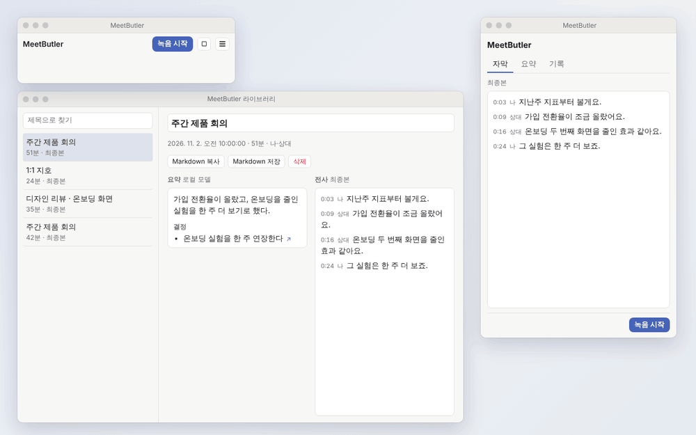
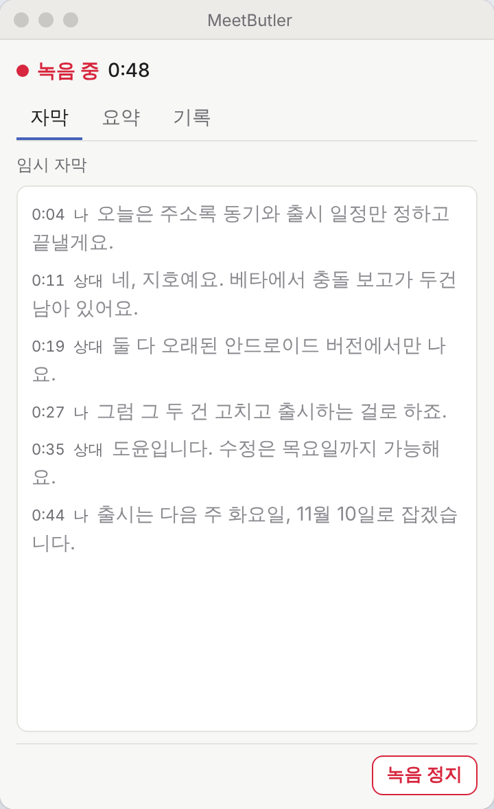
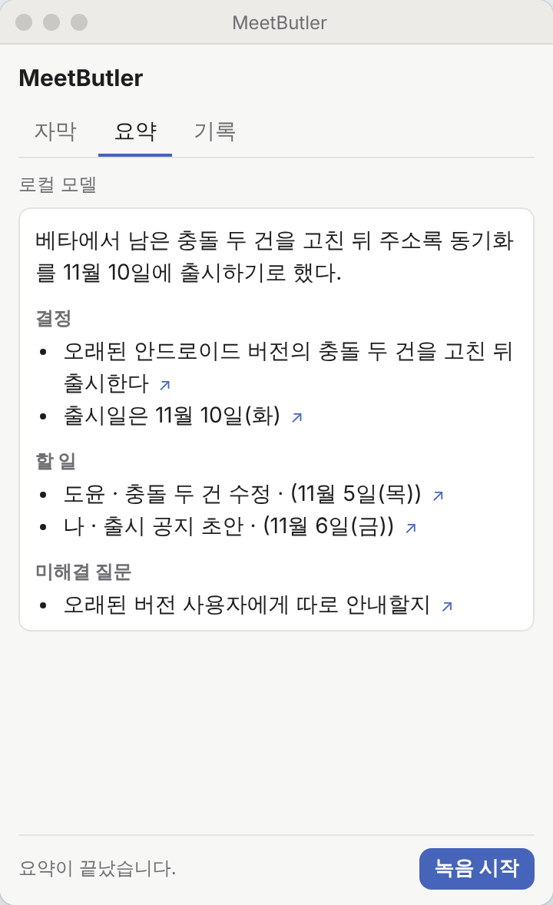
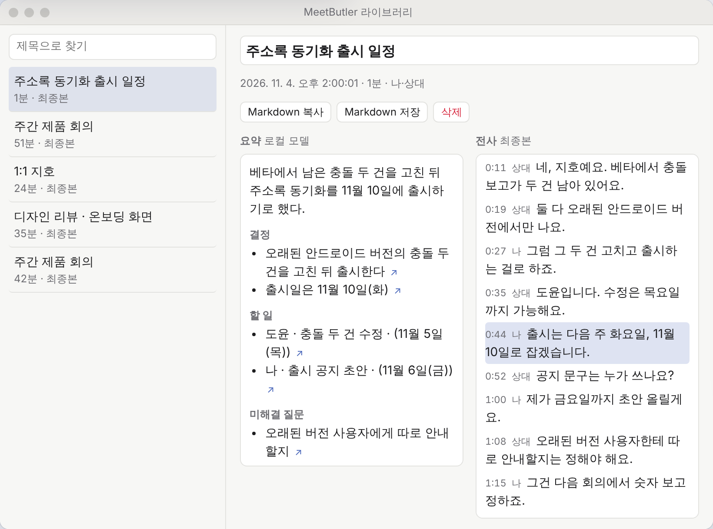

# MeetButler (formerly ghostmeet)

<p align="center">
  
</p>

**A meeting recorder that never leaves your computer.** MeetButler records your microphone
and the other side of the call as separate channels, captions the meeting live, writes a
cleaner final transcript when it ends, and summarises it with a local model. No account,
no cloud, no open port.

> **Status: 0.2 in development.** It runs on macOS (Apple Silicon) when built from
> source; there is no signed download yet. Windows builds, but system audio there has not
> been run on a real machine. What 0.2 has and still lacks: [`CHANGELOG.md`](CHANGELOG.md).
> The v0.1 Chrome extension and Python backend are in [`legacy/`](legacy/) (tag `v0.1.0`).

<p align="center">
  
</p>

<sub>The demo and the screenshots are the app's real pages playing a made-up meeting
(`app/demo-capture/`); no recording was used.</sub>

## What it does

- **Records anything you hear and say.** Web calls, desktop apps and in-person meetings:
  the microphone is "나" (me), system audio is "상대" (them), each kept as its own channel.
- **Live captions, then a final transcript.** During the meeting a small whisper model
  captions within seconds. After Stop, `large-v3-turbo` transcribes the whole meeting
  again and replaces the captions in one go. If that pass fails, the captions stay.
- **Built for long meetings.** Audio is written to disk and each live pass reads only the
  newest window, so hour four is as fast as minute four. A 4-hour meeting's final
  transcript takes about 23 minutes on an M4.
- **Nothing is lost.** Transcript lines are saved as they are recognised. After a crash
  the recording and its captions are still there, marked as interrupted.
- **A summary you can check.** Summary, decisions and action items (owner, due date),
  each with a link back to the line it came from. It runs on Qwen3.5-4B in a separate
  local process; a 1-hour meeting takes about 100 seconds on an M4.
- **Vocabulary.** Give it participant names and terms so it spells them right.
- **Library.** Past meetings with their summary beside the transcript: rename, delete,
  copy or save as Markdown.

<table>
  <tr>
    <td></td>
    <td></td>
  </tr>
  <tr>
    <td colspan="2"></td>
  </tr>
</table>

## Private by design

- **Local only.** Transcription, summary and storage all run on your machine. The app
  opens no port; its windows talk to Rust over Tauri IPC under a strict CSP. A test
  (`app/src-tauri/tests/security.rs`) fails the build if a server, an HTTP client or a
  telemetry crate gets in.
- **No telemetry, no analytics, no crash reporting.**
- **Nothing downloads on its own.** You put the models in place yourself.
- **Recording is always visible.** Nothing records until you press Start, and the red
  indicator with the elapsed time stays on screen while it does.
- **One data folder.** `meetbutler.db` and `sessions/<id>/{mic,system}.pcm` in the app's
  data folder (macOS: `~/Library/Application Support/dev.sshlab.meetbutler/`). Back it up
  or delete it as you like.

## How it works

```
microphone ──┐                         ┌─ live: whisper small ──→ captions (provisional)
             ├─→ 16 kHz mono, per ─→ PCM on disk ─→ Silero VAD cuts speech spans
system audio ┘   channel (me/them)     └─ after Stop: large-v3-turbo ──→ final transcript
                                                                    │   (one transaction)
                                                                    ▼
                                            SQLite ←── summary sidecar (llama.cpp, Qwen3.5-4B)
```

- Speech spans are cut by Silero VAD v4 (onnx on tract, pure Rust), with the same values
  live and after the meeting. A short-span filter drops whisper's known hallucinations
  ("시청해주셔서 감사합니다") without dropping real short replies.
- Timestamps come from the sample count, not from adding up chunks, so channels line up.
- The summary runs in its own executable that talks over stdin/stdout and exits when it
  is done, so its memory comes back.
- The engine choices were measured on public speech (FLEURS, AMI) and synthetic audio,
  never on real meetings: [`bench/results/RESULTS.md`](bench/results/RESULTS.md).

## Build and run (macOS, from source)

Needs Rust 1.82+, the Xcode command line tools, CMake (whisper.cpp and llama.cpp are
built from source) and macOS 13+ (system audio uses
ScreenCaptureKit).

```bash
git clone https://github.com/Higangssh/ghostmeet.git
```

```bash
cd ghostmeet
```

Download the four models into one folder (sources, sizes and licences are listed in
[`app/README.md`](app/README.md)): `ggml-small.bin`, `ggml-large-v3-turbo.bin`,
`silero_vad.onnx` and `qwen3.5-4b-Q4_K_M.gguf`. Then build the summary sidecar and run
the app:

```bash
cargo build --release -p meetbutler-summarizer --features llama
```

```bash
MEETBUTLER_MODELS=/path/to/models cargo run -p meetbutler --release
```

`app/bundle.sh` builds a `.app` and `.dmg` (signed ad hoc; another Mac's Gatekeeper will
stop it until it is signed with a Developer ID). Set `MEETBUTLER_DATA_DIR` to keep a test
run away from your real meetings. [`app/README.md`](app/README.md) has the details and the
manual checks to run before calling a build good.

## Roadmap

| Version | Goal | Core |
|---|---|---|
| 0.1.0 | ghostmeet: Chrome extension + local backend | done, in [`legacy/`](legacy/) |
| **0.2** | **First desktop version** | recording, live + final transcript, local summary, library, Markdown. Left: global shortcut, Windows checked on a real machine |
| 0.3 | In-person meetings done properly | speaker diarization, echo cancellation, "important" mark, file import, search |
| 0.4 | A butler that remembers | questions across meetings, MCP server, summary templates, companion extension |
| 0.5 | Before and after the meeting | calendar, open action items across meetings |
| 1.0 | Stable | signing and auto-update |

Full requirements: [`requirements.md`](requirements.md). Design notes for 0.3:
[`docs/`](docs/).

## Development

```bash
cargo test --workspace                     # no model, no network
```

```bash
cargo clippy --workspace --all-targets --features meetbutler-engine/whisper,meetbutler-engine/silero
```

```bash
cargo fmt --all --check
```

The slow tier (real models on synthetic speech and FLEURS) and the rules for working in
this repository are in [`CLAUDE.md`](CLAUDE.md). The README's demo and screenshots are
regenerated with `node app/demo-capture/capture.mjs` (Playwright and ffmpeg).

```
app/            desktop app (Tauri 2): src-tauri/ in Rust, ui/ the three windows
crates/
  meetbutler-engine/      spans, blocklist, PcmStore, SQLite, recorder, final pass
  meetbutler-audio/       microphone, system audio, 16 kHz mono conversion
  meetbutler-summarizer/  the summary sidecar (llama.cpp) and its client
bench/          engine, VAD, summary and diarization benchmarks on public speech
docs/           design notes
legacy/         v0.1: Chrome extension + Python backend
```

## License

[MIT](LICENSE)
