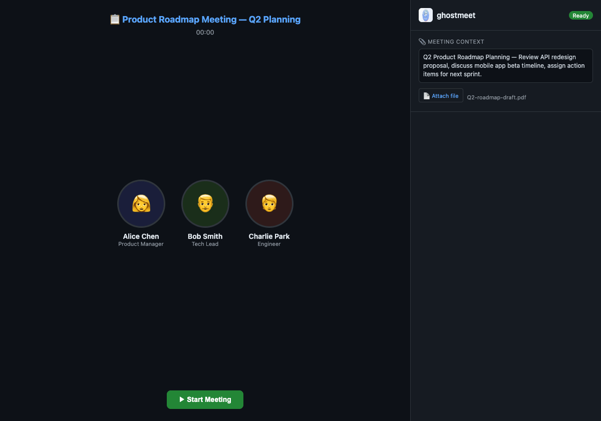

# legacy — ghostmeet v0.1

The v0.1 line, kept as it was tagged (`v0.1.0`): a Chrome MV3 extension that streams tab
audio to a local FastAPI backend (faster-whisper), with an OpenClaw skill on top. The
desktop app (`app/`, `crates/`) replaces it from 0.2; nothing new is built here. The
benchmark (`bench/`) still imports `backend/` to measure the v0.1 tail window.

```bash
cd legacy
python -m venv ../.venv && ../.venv/bin/python -m pip install -r requirements-dev.txt
../.venv/bin/python -m pytest tests/ -q          # 112 tests, no model, no network
node --test tests/extension/shared.test.mjs     # extension helpers
../.venv/bin/python -m backend                   # backend on 127.0.0.1:8877
docker compose up -d                             # or in Docker, published on loopback only
```

Run from `legacy/`: the backend now keeps its recordings in `legacy/recordings/`
(gitignored). Recordings an older checkout made in the repository root are not moved.

<p align="center">
  
</p>

The sections below are the v0.1 user guide, moved here from the repository's README when
it became MeetButler's.

## What is ghostmeet?

ghostmeet silently captures audio from any browser tab — Google Meet, Zoom, Teams, or anything with sound — and transcribes it in real-time using Whisper. When the meeting ends, click **Summarize** and AI extracts key decisions, action items, and next steps.

It runs as a **Chrome Extension side panel**. Other participants can't see it. Like a ghost in your meeting. 👻

- **100% local** — audio never leaves your machine
- **No accounts** — no sign-up, no cloud, no subscriptions
- **Works everywhere** — any tab that plays audio

### Features

- 🎙️ **Real-time transcription** — Whisper STT, updates every 10 seconds
- ⏱️ **Built for long meetings** — cost per pass stays flat, so a 4-hour session behaves like a 4-minute one
- 📋 **AI-powered summaries** — Key decisions, action items, next steps
- 💾 **Nothing is lost** — transcripts are written to SQLite as they happen and survive a restart
- 🌏 **Per-meeting language** — pick the language in the side panel, or let Whisper detect it
- 🔒 **Self-hosted** — your audio stays on your machine, and the server listens on loopback only
- 🐳 **One-command setup** — `docker compose up` and you're ready
- 👻 **Invisible** — side panel UI, no one in the meeting knows

### How It Works

```
Browser Tab (Zoom / Meet / Teams)
    │ audio
    ▼
Chrome Extension
    ├── service worker  — asks Chrome for a tab stream id
    └── offscreen page  — records it, and plays it back so you still hear the meeting
    │
    ▼  WebSocket (webm/opus, 1s chunks)
Local Backend (FastAPI)
    ├── one demuxer per session  ──→ PCM appended to disk
    ├── Whisper reads only the newest window, never the whole recording
    ├── segments ──→ SQLite  +  live captions in the side panel
    └── Claude API (on demand) ──→ Meeting Summary
```

Everything runs on your machine. The only external call is to Claude API when you click Summarize (optional — transcription works without it).

Audio is decoded once as it arrives and kept on disk, and each transcription pass reads
only a bounded window of it. That is what keeps a long meeting from getting slower and
slower, and keeps memory flat no matter how long you record.

## Quick Start

### Prerequisites

- **Docker** (recommended) or Python 3.10+
- **Chrome** browser

### 1) Start the backend

```bash
git clone https://github.com/Higangssh/ghostmeet.git
cd ghostmeet/legacy

# Copy and edit config (add your Anthropic API key for summaries)
cp .env.example .env

# Start with Docker
docker compose up -d
```

Backend is ready when you see `http://0.0.0.0:8877` in the logs.

<details>
<summary><strong>Manual install (without Docker)</strong></summary>

```bash
python3 -m venv .venv && source .venv/bin/activate
pip install -r requirements.txt
python -m backend
```

Note: First run downloads the Whisper model (~150MB for `base`).
</details>

### 2) Install Chrome Extension

1. Open **chrome://extensions** in Chrome
2. Enable **Developer mode** (toggle in top-right)
3. Click **Load unpacked**
4. Select the `legacy/extension/` folder from this repo
5. Pin the 👻 icon in your toolbar

### 3) Use it

1. **Join a meeting** — Open Google Meet, Zoom, Teams (or any tab with audio)
2. **Click 👻** — Side panel opens on the right
3. **Pick a language** (optional) — or leave it on Auto-detect
4. **Click ▶ Start** — Live captions appear as people speak. The tab stays audible.
5. **Click ■ Stop** — The panel says "Transcription complete" once the last pass finishes
6. **Click 📋 Summarize** — AI generates a structured summary

Reopening the side panel mid-meeting brings the transcript so far back with it.

That's it. No sign-up, no config, no cloud.

## Configuration

Set these in `.env` or `docker-compose.yml`:

| Variable | Default | Description |
|----------|---------|-------------|
| `GHOSTMEET_MODEL` | `base` | Whisper model size (`tiny` / `base` / `small` / `medium` / `large`) |
| `GHOSTMEET_DEVICE` | `auto` | Compute device (`auto` / `cpu` / `cuda`) |
| `GHOSTMEET_COMPUTE_TYPE` | `float32` | Precision (`int8` is much faster on CPU) |
| `GHOSTMEET_LANGUAGE` | auto-detect | Default language (`en` / `ko` / `ja` / etc.) — the side panel can override it per meeting |
| `GHOSTMEET_CHUNK_INTERVAL` | `10` | Seconds between transcription updates |
| `GHOSTMEET_ANTHROPIC_KEY` | — | Required for AI summaries |
| `GHOSTMEET_HOST` | `127.0.0.1` | Server bind address (loopback — the API has no auth) |
| `GHOSTMEET_PORT` | `8877` | Server port |

**Model size guide:**
- `tiny` — fastest, least accurate (~75MB)
- `base` — good balance (recommended, ~150MB)
- `small` — better accuracy, slower (~500MB)
- `medium` / `large` — best accuracy, needs GPU

## API

| Endpoint | Method | Description |
|----------|--------|-------------|
| `/api/health` | GET | Health check + model info |
| `/api/sessions` | GET | List all sessions |
| `/api/sessions/{id}` | GET | Session details |
| `/api/sessions/{id}/transcript` | GET | Full transcript |
| `/api/sessions/{id}/summarize` | POST | Generate AI summary |
| `/api/sessions/{id}/summary` | GET | Get generated summary |
| `/ws/audio` | WS | Audio ingest (binary chunks; send `stop` as text to finish) |
| `/ws/transcript/{id}` | WS | Live transcript stream |

Sessions, transcripts and summaries are stored in `legacy/recordings/ghostmeet.db`, so every
endpoint above keeps working after the backend restarts.

## OpenClaw Integration

ghostmeet works as an [OpenClaw](https://github.com/openclaw/openclaw) skill. Control your meetings from chat.

```bash
# Install the skill
clawhub install ghostmeet
```

Then just ask your AI assistant:

- **"Summarize my last meeting"** → generates AI summary from latest session
- **"How many meetings did I have today?"** → lists all sessions
- **"What was discussed?"** → fetches full transcript
- **"Extract action items"** → pulls tasks from the summary

> The skill handles session listing, transcript retrieval, and summary generation via the ghostmeet API. Recording start/stop is done through the Chrome Extension.
